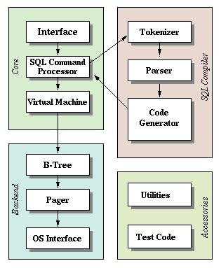

#+TITLE: SQLite 架构
#+HTML_HEAD: <link rel="stylesheet" type="text/css" href="css/main.css" />
#+HTML_LINK_UP: introduction.html   
#+HTML_LINK_HOME: sqlite.html
#+OPTIONS: num:nil timestamp:nil ^:nil

SQLite拥有一个精致的、模块化的体系结构，并引进了一些独特的方法进行关系型数据库的管理。它由被组织在 _3个子系统_ 中的 _8个独立的模块_ 组成，这些模块又被分割为两个部分:  *前端解析* 系统和 *后端引擎* ，如图所示：

#+ATTR_HTML: image :width 90% 
[[file:pic/2.jpg]]

+ 前端预处理应用程序传递过来的SQL语句和SQLite命令，对获取的编码分析、优化，并转换为后端能够执行的SQLite内部字节编码。前端可分为三个模块：
  1. 标示分析
  2. 语法分析
  3. 代码生成器
+ 后端是用来解释字节编码程序的引擎，这个引擎做的才是真正的数据库处理工作。后端部分由四个模块组成：
  1. 虚拟机(VM)
  2. B/B+树
  3. 页面调度程序(pager)
  4. 操作系统交界面
     #+begin_example
       后端实现了 sqlite3_bind_*, sqlite3_setp, sqlite3_coloumn_*, sqlite3_reset和sqlite3_finalize 等API函数
     #+end_example

#+begin_example
  这个模型将查询过程划分为几个不连续的任务，就像在流水线上工作一样

  在体系结构栈的顶部编译查询语句，在中部执行它，在底部处理操作系统的存储和接口
#+end_example
* 体系结构
在内部，SQLite由以下几个组件组成：内核、SQL编译器、后端以及附件
+ SQLite通过利用 *虚拟机和虚拟数据库引擎* _VDBE_ ，使调试、修改和扩展SQLite的内核变得更加方便
  + 所有SQL语句都被编译成易读的、可以在SQLite虚拟机中执行的程序集
+ SQLite支持大小高达2 TB的数据库，每个数据库完全存储在单个磁盘文件中
  + 这些磁盘文件可以在不同字节顺序的计算机之间移动
  + 这些数据以B+树（B+tree）数据结构的形式存储在磁盘上
  + SQLite根据该文件系统获得其数据库权限

SQLite的体系结构图，如图所示:

#+ATTR_HTML: image :width 90% 

** 公共接口Interface 
SQLite库的大部分公共接口由 _main.c_ , _legacy.c_ 和 _vdbeapi.c_ 源文件中的函数来实现，这些函数依赖于分散在其他文件中的一些程序，因为在这些文件中它们可以访问有文件作用域的数据结构 

** 词法分析器Tokenizer 
当执行一个包含SQL语句的字符串时，接口程序要把这个字符串传递给 _tokenizer_
+ Tokenizer的任务是把原有字符串分割成一个个 *标识符* _token_
+ 把这些标识符传递给解析器

Tokenizer是用手工编写的，在C文件 _tokenize.c_ 中 

** 语法分析器Parser 
语法分析器的工作是在指定的上下文中赋予标识符具体的含义。SQLite的 *语法分析器* 使用 _Lemon LALR(1)_ 分析程序生成器来产生
+ Lemon做的工作与YACC/BISON相同，但它使用不同的输入句法，这种句法更不易出错
+ Lemon还产生可重入的并且线程安全的语法分析器
+ Lemon定义了非终结析构器的概念，当遇到语法错误时它不会泄露内存

驱动Lemon的源文件可在 _parse.y_ 中找到

** 代码生成器Code Generator
语法分析器在把标识符组装成完整的SQL语句后，就调用代码生成器产生虚拟机代码，以执行SQL语句请求的工作。代码生成器包含许多文件：
+ attach.c
+ auth.c
+ build.c
+ delete.c
+ expr.c
+ insert.c
+ pragma.c
+ select.c
+ trigger.c
+ update.c
+ vacuum.c
+ where.c

这些文件涵盖了大部分最重要、最有意义的事情
1. expr.c处理SQL中表达式的代码生成
2. where.c处理SELECT、UPDATE和DELETE语句中WHERE子句的代码生成
3. attach.c, delete.c, insert.c, select.c, trigger.c, update.c和vacuum.c处理同名SQL语句的代码生成（这些文件在必要时都调用expr.c和where.c中的例程）
4. 所有其他SQL语句的代码由build.c生成。文件auth.c实现sqlite3_set_authorizer()的功能

** 虚拟机Virtual Machine
代码生成器生成的代码由虚拟机来执行。总的来说，虚拟机实现一个专为操作数据库文件而设计的 *抽象计算引擎*
+ 它有一个存储中间数据的 _存储栈_
+ 每条指令包含 _一个操作码_ 和 _不超过三个额外的操作数_ 

** B-树B-Tree
一个SQLite数据库使用 *B-树* 的形式存储在磁盘上，B-树的实现位于源文件 _btree.c_ 中
+ 数据库中的 _每个表_ 和 _索引_ 使用一棵 *单独的* B-树
+ 所有的B-树存放在 _同一个磁盘文件_ 中
+ 文件格式的细节被记录在 _btree.c开头的备注_ 里
+ B-树子系统的接口在头文件 _btree.h_ 中定义

** 页面高速缓存Page Cache
B-树模块以固定大小的数据块形式从磁盘上请求信息，默认的块大小是 _1024_ 个字节，但是可以在512和65536个字节之间变化
+ 页面高速缓存负责 _读_ 、 _写_ 和 _缓存_ 这些数据块
+ 页面高速缓存还提供 _回滚_ 和 _原子提交_ 的抽象，并且管理数据文件的 _锁定_
+ B-树驱动模块从页面高速缓存中请求特定的页
+ 当它想修改页面、想提交或回滚当前修改时，它也会通知页面高速缓存
  #+begin_example
    页面高速缓存处理所有麻烦的细节，以确保请求能够快速、安全而有效地被处理
  #+end_example
页面高速缓存的代码实现被包含在单一的C源文件 _pager.c_ 中。页面高速缓存子系统的接口在头文件 _pager.h_ 中定义

** OS接口
为了在POSIX和Win32操作系统之间提供移植性，SQLite使用一个 *抽象层* 来提供操作系统接口
+ OS抽象层的接口在 _os.h_ 中定义
+ 每种支持的操作系统有各自的实现：
  + Unix使用os_unix.c
  + Windows使用os_win.c，等等
  + 每个特定操作系统的实现通常都有自己的头文件，如os_unix.h, os_win.h等

** 实用工具 Utilities 
+ 内存分配和字符串比较函数位于 _util.c_ 中
+ 语法分析器使用的符号表用Hash表来维护，其实现位于 _hash.c_ 中
+ 源文件 _utf.c_ 包含Unicode转换子程序
+ SQLite有自己的printf()实现（带一些扩展功能），在 _printf.c_ 中
+ 还有自己的随机数生成器，在 _random.c_ 中

** 测试代码 
如果计算回归测试脚本，超过一半的SQLite代码将被测试
+ 主要代码文件中有许多assert()语句
+ 源文件test1.c通过test5.c和md5.c实现只用于测试目的的一些扩展
+ os_test.c后端接口用来模拟断电，以验证页面高速缓存的崩溃恢复机制

* 模块作用
SQLite 由以下几个主要模块组成：SQL 编译器、内核、后端。
+ *接口* ：接口由SQLite C API组成，程序可以通过API与SQLite数据库进行交互
+ *编译器* ：
  1. *分词器* _Tokenizer_ 和 *分析器* _Parser_ 对执行的SQL语句进行语法检查
  2. 生成 *语法树* 方便 *VDBE代码生成器* 使用
  3. 把语法树传给 *VDBE代码生成器* _Code Generator_ 处理
  4. 代码生成器根据语法树生成 *VDBE的类汇编语言操作码*
+ *后端* ：由 *B-树* _B-tree_ ， *页缓存管理* _pager_ 和 *操作系统接口* 构成。B-tree和Pager共同对数据进行管理
  + B-tree用与对数据建立索引，它维护着各个页面之间的复杂的关系，便于快速找到所需数据
  + Pager的主要作用就是通过OS接口在B-tree和硬盘之间传递页面

#+ATTR_HTML: :border 1 :rules all :frame boader
| [[file:vbde/vbde.org][Next: 进程]] | [[file:introduction.org][Previous：简介]] | [[file:sqlite.org][Home: SQLite 源码分析]] |
