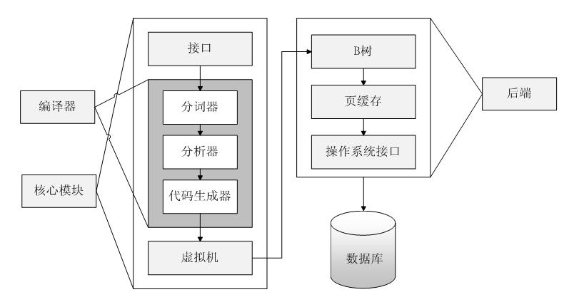

#+TITLE: SQLite 架构
#+HTML_HEAD: <link rel="stylesheet" type="text/css" href="css/main.css" />
#+HTML_LINK_UP: introduction.html   
#+HTML_LINK_HOME: sqlite.html
#+OPTIONS: num:nil timestamp:nil ^:nil

SQLite拥有一个精致的、模块化的体系结构，并引进了一些独特的方法进行关系型数据库的管理。它由被组织在 _3个子系统_ 中的 _8个独立的模块_ 组成，这些模块又被分割为两个部分:  *前端解析* 系统和 *后端引擎* ，如图所示：

#+ATTR_HTML: image :width 90% 

+ 前端预处理应用程序传递过来的SQL语句和SQLite命令，对获取的编码分析、优化，并转换为后端能够执行的SQLite内部字节编码。前端可分为三个模块：
  1. 标示分析
  2. 语法分析
  3. 代码生成器
+ 后端是用来解释字节编码程序的引擎，这个引擎做的才是真正的数据库处理工作。后端部分由四个模块组成：
  1. 虚拟机(VM)
  2. B/B+树
  3. 页面调度程序(pager)
  4. 操作系统交界面
     #+begin_example
       后端实现了 sqlite3_bind_*, sqlite3_setp, sqlite3_coloumn_*, sqlite3_reset和sqlite3_finalize 等API函数
     #+end_example

#+begin_example
  这个模型将查询过程划分为几个不连续的任务，就像在流水线上工作一样

  在体系结构栈的顶部编译查询语句，在中部执行它，在底部处理操作系统的存储和接口
#+end_example
* 体系结构
* 模块作用
